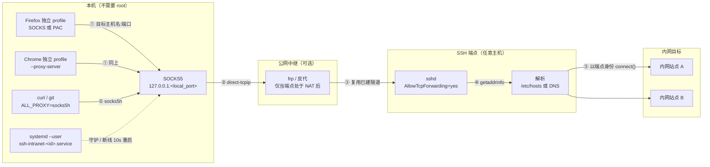

# ssh-intranet-tunnel

把**任意一台 SSH 可达主机**变成内网出口：本机开一个 SOCKS5 监听口，域名在**对端**解析，从而访问只有该主机能到达的内网站点。

零 root、零对端改动、零额外依赖（复用已装 `ssh`）；本地只落三样东西：`~/.local/bin/intra-tun`、每连接的 `systemd --user` 单元、可选的一个独立 Firefox profile。



关键点：客户端只发**主机名**，解析发生在端点上，因此本机不需要配置任何内网 DNS；TLS 端到端保持真实域名，不会出现 `-L` 端口转发那种 Host/SNI 变成 `127.0.0.1:port` 导致的 404。

## 适用场景

- 临时/按需访问对端内网 Web、API、GitLab、K8s Dashboard、Argo CD 等 **HTTP(S) 服务**。
- 手上有任意一台能 SSH 的跳板（办公室笔记本、树莓派、云主机），不想在它上面装软件、开端口、改 sshd。
- 只希望**部分应用**走内网、主力浏览器继续走公网（独立 profile / PAC 白名单）。
- 需要按域名/端口收紧可访问范围（对端 `permitopen` 或客户端 PAC）。
- 多端点并行：不同端点用不同本地端口，互不影响。

不适合：需要 `ping`、UDP、任意私有协议的场景；需要整机透明路由或全局内网 DNS 的场景 —— 那些用 `roles/wireguard-client`（L3），见文末对比。

## 前置条件

| 项 | 要求 | 检查方式 |
|---|---|---|
| 本机 | `ssh` 可执行（OpenSSH 客户端）；可选 `systemd --user`（常驻） | `ssh -V`、`systemctl --user is-system-enabled` |
| 登录 | 到端点**免交互**公钥登录（BatchMode） | `ssh -o BatchMode=yes HOST true` |
| 端点 sshd | 允许 TCP 转发（`AllowTcpForwarding` 默认 `yes`）；无需 `PermitTunnel`/`GatewayPorts` | `ssh -o BatchMode=yes -W 127.0.0.1:22 HOST </dev/null` 有 banner 即通过 |
| 端点路由 | 能到达目标网段 | `ssh HOST 'getent hosts NAME; bash -c "</dev/tcp/IP/PORT"'` |
| 名字解析 | 端点的 `/etc/hosts` 或 DNS 能解析目标域名 | 同上 |
| 网络 | 本机→端点可达；端点 NAT 后则需公网中继（如 frp 映射） | `ssh -o ConnectTimeout=8 HOST true` |
| 目标 | 无要求 | — |

`intra-tun probe HOST [host:port ...]` 会把上面第 2～4 项一次性跑完。

## 变量

| 变量 | 默认 | 说明 |
|---|---|---|
| `ssh_intranet_tunnel_connections` | `[]` | 连接列表，见下方字段 |
| `ssh_intranet_tunnel_install_cli` | `true` | 安装 `intra-tun` 到 `~/.local/bin` |
| `ssh_intranet_tunnel_ssh` | `/usr/bin/ssh` | ssh 客户端路径 |
| `ssh_intranet_tunnel_server_alive` | `30` | 保活间隔 |
| `ssh_intranet_tunnel_xdg_runtime_dir` | `/run/user/<uid>` | `systemctl --user` 所需环境 |
| `ssh_intranet_tunnel_wait_timeout` | `20` | 等待监听口就绪秒数 |

连接字段：

| 字段 | 必填 | 说明 |
|---|---|---|
| `id` | 是 | 单元名 `ssh-intranet-<id>.service`、日志标签 |
| `ssh_host` | 是 | `~/.ssh/config` 里的 Host 或任意 hostname/IP（角色**不写** ssh config） |
| `local_port` | 是 | 本机 SOCKS5 端口（仅绑 `127.0.0.1`） |
| `systemd` | 否(默认 true) | `false` 时只装 CLI/profile，隧道由 `intra-tun start` 手动起 |
| `autostart` | 否(默认 true) | 用户登录后自启 |
| `firefox_profile` | 否(默认 false) | 生成独立 profile（snap 版 Firefox 自动放 `~/snap/...`） |
| `desktop_entry` | 否(默认 true) | 为独立 profile 生成桌面启动项（应用网格 / launcher 可搜索），仅 `firefox_profile` 生效 |
| `domains` | 否(`[]`) | 空=全量 SOCKS；非空=PAC 白名单（`*.suffix` 支持后缀匹配） |
| `identity_file` | 否 | 专用密钥（配合对端 `authorized_keys permitopen` 收紧范围） |
| `ssh_options` | 否 | 额外 `-o`，例如 `["ConnectTimeout=10"]` |
| `verify_targets` | 否(`[]`) | 部署后用 `curl --socks5-hostname` 逐个验证的 URL |

## 用法

```bash
# 1) inventory/group_vars/all.yml 里开启并定义连接
install_ssh_intranet_tunnel: true
ssh_intranet_tunnel_connections:
  - id: oxygen
    ssh_host: Oxygen
    local_port: 11080
    systemd: true
    firefox_profile: true
    domains: []
    verify_targets: ["https://cube.ops-wxdc.vsat.cloud/"]

# 2) 只跑本 role
ansible-playbook playbooks/app.yml --tags ssh-intranet

# 3) 验证
intra-tun status
curl -sS -o /dev/null -w '%{http_code}\n' --socks5-hostname 127.0.0.1:11080 https://cube.ops-wxdc.vsat.cloud/
firefox --profile ~/snap/firefox/common/.mozilla/firefox/intra-Oxygen
```

桌面启动项（`desktop_entry: true`，默认开启）会写成
`~/.local/share/applications/ssh-intranet-firefox-<id>.desktop`，显示名 `Firefox · 内网 <id>`：

- GNOME：应用网格里搜索“内网”即可，右键可固定到 Dock。
- Hyprland / rofi / wofi：`drun` 模式直接搜到。
- 等价命令行验证：`gtk-launch ssh-intranet-firefox-<id>`。

启动项用 `--new-instance`，因此可以和普通 Firefox 同时运行；两个实例的 cookie/登录态互不干扰。

CLI（角色安装，也可脱离 Ansible 用）：

```bash
intra-tun probe  HOST [host:port ...]   # 检查端点是否满足前置条件
intra-tun start  HOST [PORT]            # 起 ad-hoc SOCKS5（默认 11080）
intra-tun stop   HOST|all
intra-tun status
intra-tun env    HOST                   # export ALL_PROXY=socks5h://...
intra-tun firefox HOST                  # 独立 profile + 远端 DNS
intra-tun chrome  HOST
intra-tun pac    HOST DOMAIN... [*.suffix]   # 生成 PAC 白名单
intra-tun allow  HOST host:port ...     # 专用受限密钥 + authorized_keys 行
```

## 访问范围控制（三层，实测规则）

| 层 | 配置 | 匹配规则 | 需要 root |
|---|---|---|---|
| sshd 全局 | `PermitOpen`（`sshd_config` 或 `Match` 块） | `host:port` 字面串、`*:port`、`host:*`、`any`、`none`；**不支持 `*.suffix:port`** | 是 |
| 每密钥（推荐） | `~/.ssh/authorized_keys` 中 `permitopen="h:p"` | 同上；**不能与 `restrict` 同时使用**（实测 `restrict,permitopen` 会把白名单一起禁掉） | 否 |
| 客户端 | `domains` → PAC；或 Chrome `--proxy-bypass-list` | 任意逻辑，含 `dnsDomainIs` 后缀 | 否 |

服务端按名字匹配时要求客户端发**主机名**而非 IP：Firefox 由 `socks_remote_dns=true` 保证，`curl` 用 `--socks5-hostname` / `socks5h://`，Chrome 对 SOCKS5 默认远端解析。

## 局限性

- **只有 TCP**：ICMP、UDP、SOCKS 不友好的客户端（如 `kubectl` 默认不认 SOCKS）走不通；这类需求用 WireGuard。
- **按应用生效**：浏览器/命令需各自配代理，没有整机透明路由，也没有全局内网 DNS/search 域。
- **端点依赖**：端点下线、或 NAT 后的中继（frp 等）断开，全部通道中断；性能也受中继与端点上行限制（单 SSH 连接多路复用）。
- **名字白名单是枚举式**：`permitopen` 无后缀通配；一个 DNS 记录带多个别名（如 `cube` 与 `in-lb`）必须逐条列出。
- **命名空间差异**：同一后端可能按 SNI/Host 分流（实测同 IP 下 `cube` 200、`in-lb` 404），URL 要用应用真实域名。
- **SOCKS 口无认证**：已绑定 `127.0.0.1`，但本机任意进程/本地用户都可使用；不要改绑 `0.0.0.0`。

## 与 `wireguard-client` 的边界

| | 本 role（SSH + SOCKS5） | `wireguard-client` |
|---|---|---|
| 层 | L4，按连接 | L3，整块路由 |
| 客户端权限 | 普通用户 | 需 `wireguard-tools` + NM + 特权 |
| 对端改动 | 无 | 需 peer 公钥、AllowedIPs、转发/NAT，且 **UDP 可达** |
| 协议覆盖 | 仅 TCP | ICMP/UDP/任意 TCP，工具无感 |
| DNS | 逐连接远端解析 | 接口级 `dns` + `dns-search`，全机透明 |
| 粒度 | 端口/域名级 | IP 段级 |
| 适用 | 临时看内网 Web/API，最少足迹 | 长期、全协议、整段访问 |

两者可共存：SOCKS 只占一个本地端口，不改路由表。

## 排错

```bash
systemctl --user status ssh-intranet-<id>.service
journalctl --user -u ssh-intranet-<id> -n 50
ss -lntp | grep <local_port>
ssh -v -N -D 127.0.0.1:<port+1> <ssh_host> 2>&1 | grep direct-tcpip
```

- 端口被占：换 `local_port`，或先停掉旧的 ad-hoc 单元（如早期手写的 `oxygen-tunnel.service`）。
- `administratively prohibited`：服务端 `permitopen`/`PermitOpen` 未放行该 `host:port`。
- 浏览器提示无法连接但端口在听：检查 `socks_remote_dns` 是否生效、PAC 是否包含该域名。
- 页面 404 而 curl 200：确认 URL 用的是应用真实域名，而非负载均衡名。

## 卸载

```bash
systemctl --user disable --now ssh-intranet-<id>.service
rm ~/.config/systemd/user/ssh-intranet-<id>.service
rm -rf ~/snap/firefox/common/.mozilla/firefox/intra-<ssh_host>
rm ~/.local/bin/intra-tun
rm ~/.local/share/applications/ssh-intranet-firefox-<id>.desktop
```
